# Review — 01 · F1 처음 쏟아내기

> Vibe Studio · build-check · 최신 점검이 위에 있어요

## 2026-10-16 · 목표: UI 구현 · 걸어본 플로우: F1

**한 줄 결론:** 목표 순간("오늘은 이 세 가지만 하면 돼요.")까지 막힘 없이 가요. 어긋난 곳 1개, 위험 없음.

> 이 묶음을 만든 대화에서 바로 점검했어요. 새 대화에서 build-check를 다시 부르면 더 꼼꼼히 볼 수 있어요.
> 폰 너비(390px) 화면은 Chrome을 화면 없이 띄워 찍었어요. 진짜 휴대폰과 아이폰 Safari에서는 확인하지 못했어요.

### 걸어본 길
| 단계 | 화면 | 결과 | 스크린샷 |
|:--:|------|------|------|
| ① | 첫 화면 | 통과 | 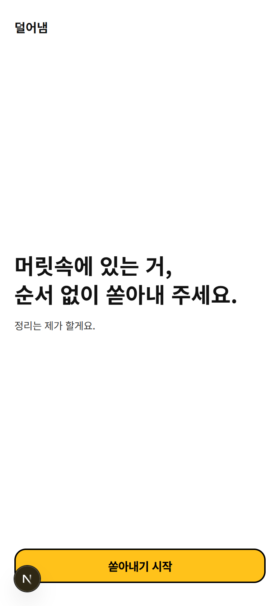 |
| ② | 쏟아내기 — 빈 상태 | 통과 | 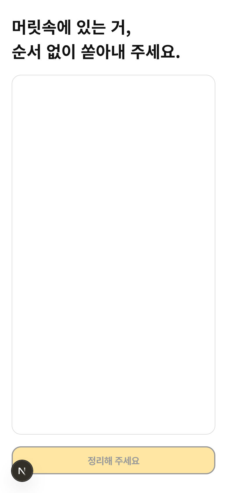 |
| ② | 쏟아내기 — 적은 상태 | 통과 | 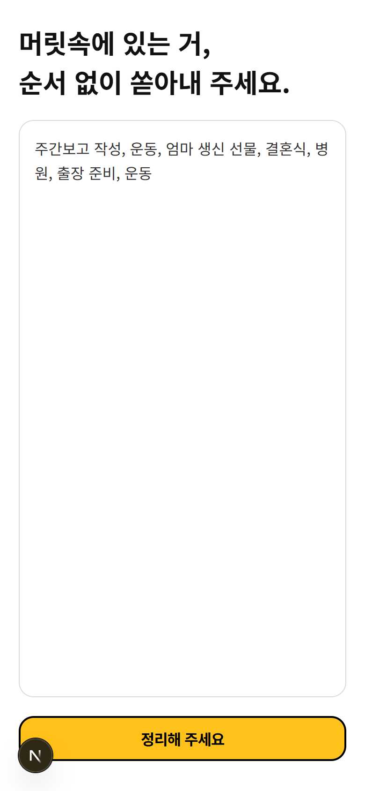 |
| ② | 정리하는 중 | 통과 | 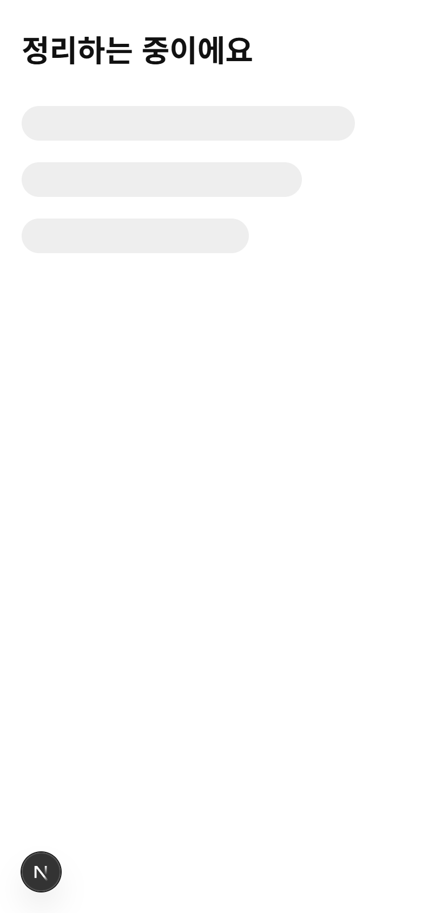 |
| ③ | 오늘 세 가지 | 어긋남 1 — 목표 순간 도착 | 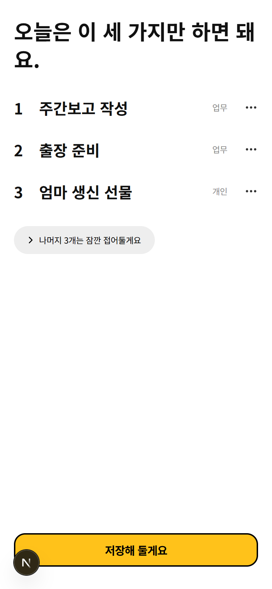 |
| ③ | 나머지 펼침 | 통과 | 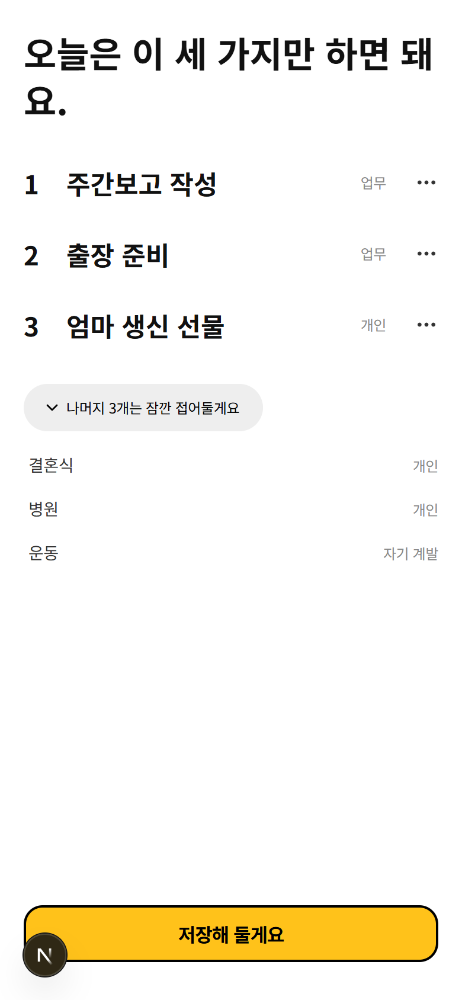 |
| ③ | `⋯` 메뉴 | 통과 | 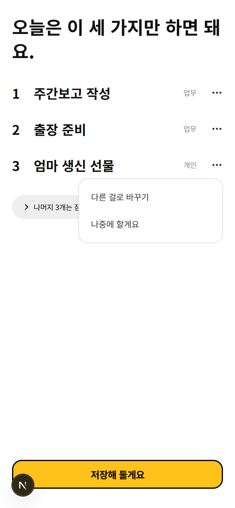 |
| ③ | 다른 걸로 바꾸기 | 통과 | 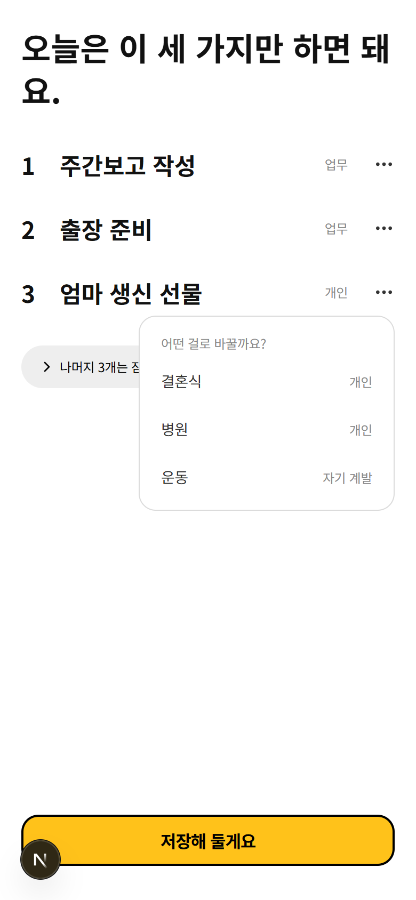 |
| ③ | 나중에 할게요 → 빈자리 채움 | 통과 (다듬을 것 1) | 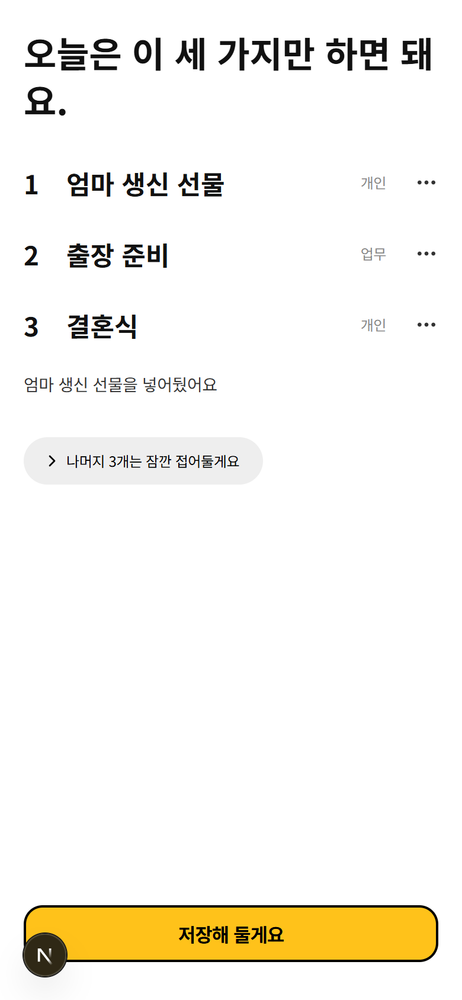 |
| ④ | 저장 시트 | 통과 | 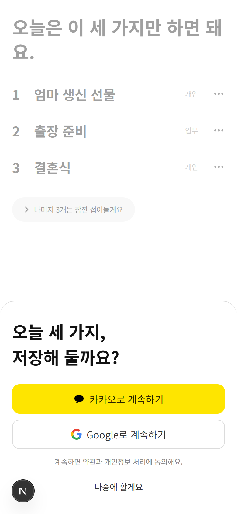 |
| ⑤ | 아침 알림 시트 | 통과 | 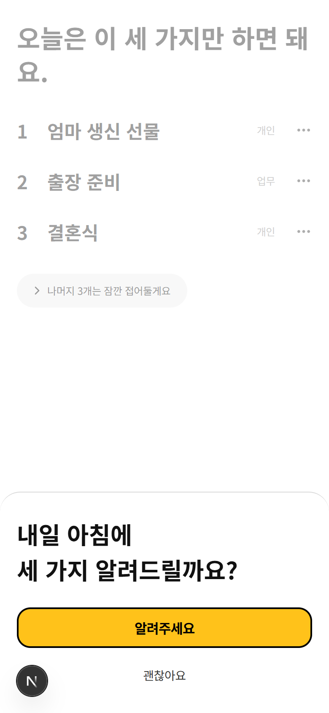 |
| ⑤ | 괜찮아요 뒤 오늘 화면 | 통과 | 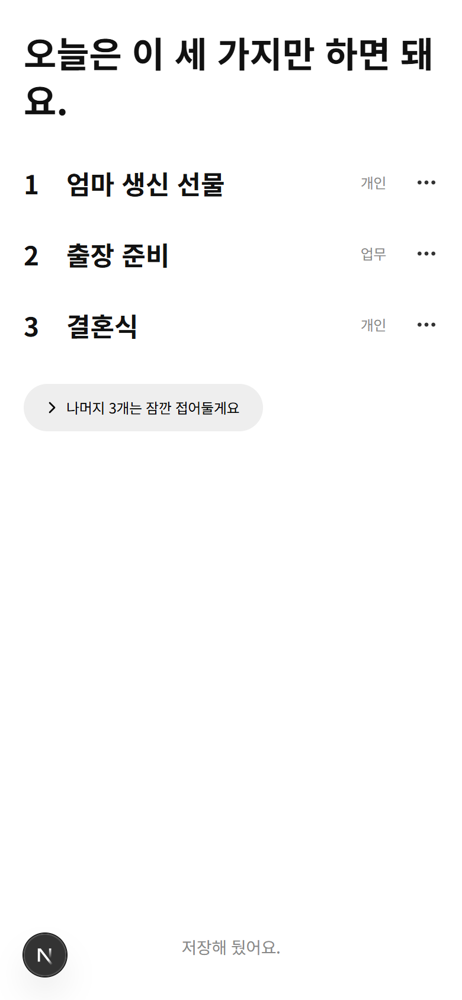 |

**상태·예외**
| 상황 | 결과 | 스크린샷 |
|------|------|------|
| 할 일을 못 찾음 ("ㅋㅋㅋ, ...") → [다시 쏟아내기] → ② | 통과 (어긋남 1과 같은 줄바꿈) | 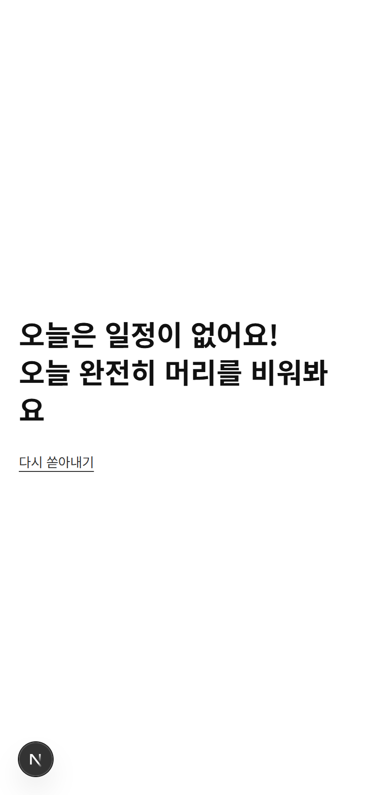 |
| 오늘 꼭 할 일이 넷 → 넷 다, 제목 "오늘은 이것만 하면 돼요." | 통과 | 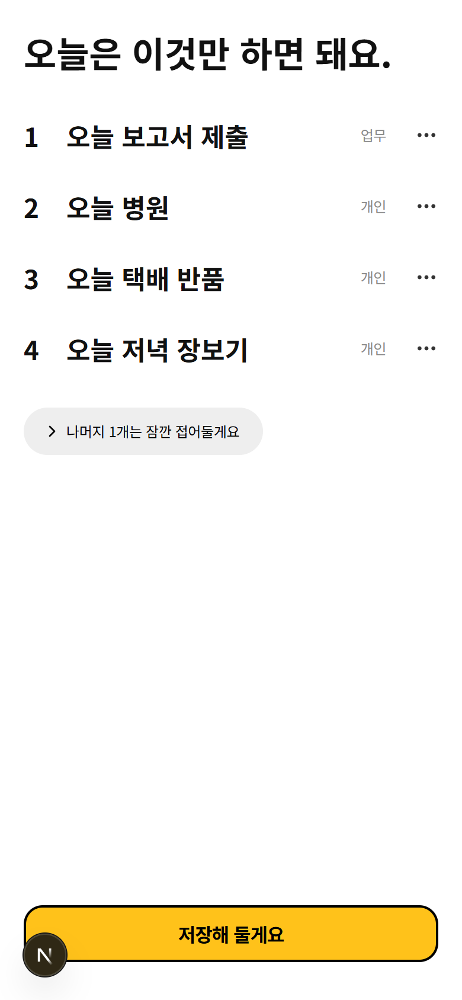 |
| 접어둔 게 없을 때 나중에 → 남은 것만 | 통과 | 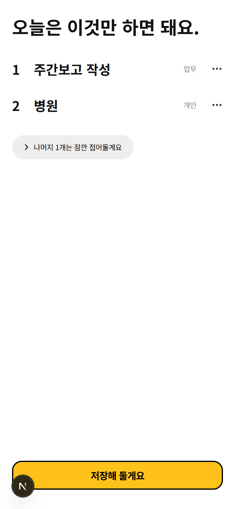 |
| 긴 할 일 | 가로로 넘치지 않음 (어긋남 1과 같은 줄바꿈) | 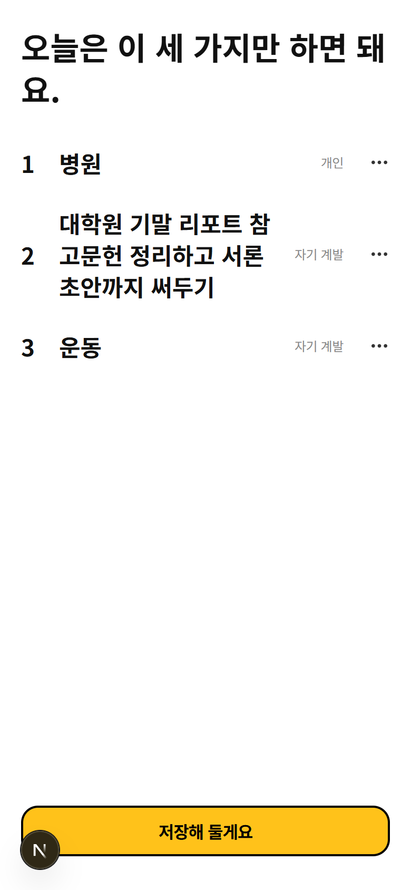 |
| 넓은 화면 (1280px) | 괜찮음 | 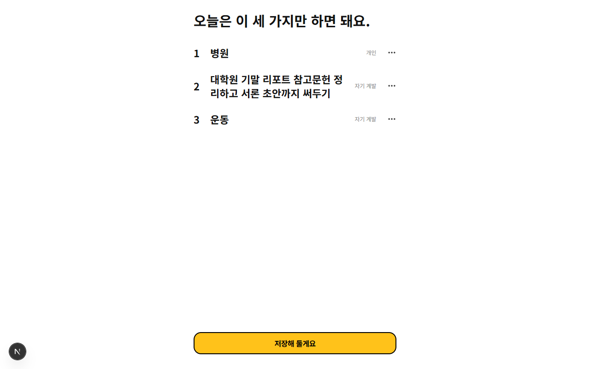 |
| 쓰다가 나갔다 오기 · 로그인 전에 나갔다 오기 · 같은 일 두세 번(띄어쓰기 달라도) · 빈칸·공백만 적고 누르기 · 시트 바깥 누르기 · 알림 거절 뒤 새로고침 | 모두 통과 | — |

확인 기준 14개 중 14개 통과 · 콘솔 에러 없음 · 넓은 화면 괜찮음 · 강조색 버튼은 화면마다 하나 · 글꼴 Pretendard · VOICE 금지어 없음

### 문제
| # | 종류 | 어디서 | 무엇이 | 고치려면 (build-slice에 그대로) |
|:--:|------|--------|--------|------|
| 1 | 어긋남 | ③ 오늘 세 가지 제목, ③ 할 일을 못 찾음, 긴 할 일 (폰 너비) | 한 낱말이 중간에서 끊겨 줄이 바뀜: "하면 돼 / 요.", "비워봐 / 요", "참 / 고문헌". FLOWS ③은 제목을 "오늘은 이 세 가지만 / 하면 돼요."로 두 줄 배치 | "한국어 글이 낱말 중간에서 줄이 바뀌지 않게 앱 전체를 띄어쓰기 단위로 줄바꿈되게 하고, 오늘 세 가지 제목은 FLOWS F1 ③처럼 '오늘은 이 세 가지만 / 하면 돼요.' 두 줄로 보여줘" |

### 다듬으면 좋을 것
- `⋯` → "다른 걸로 바꾸기"로 뺀 일이, 다른 항목을 "나중에 할게요" 하면 바로 빈자리로 다시 올라와요(엄마 생신 선물을 결혼식으로 바꾼 뒤 주간보고를 나중으로 미루자 엄마 생신 선물이 1번으로 돌아옴). 방금 뺀 일은 빈자리 채우기에서 한 번 건너뛰면 덜 헷갈려요.
- 진짜 카카오 로그인을 붙일 때는 카카오 공식 디자인 가이드의 버튼 문구·말풍선 기호 규칙을 다시 맞춰야 해요(지금은 흉내라 FLOWS 문구 "카카오로 계속하기"를 그대로 씀).

### 기획과 달라진 점 (→ userflow-generator)
- 주요 버튼은 primary-action 색·테두리·모서리를 쓰되 폰에서 누르기 쉽게 높이 48px·글자 16px·가로 꽉 차게 키움 (LOG 10/16)
- 쏟아내기 입력칸 글자는 아이폰에서 화면이 확대되지 않게 16px (LOG 10/16)
- 오늘 세 가지 항목 글자는 today-three-card(30px)보다 작은 22px 굵게 (LOG 10/16)
- 할 일이 셋보다 적을 때도 제목을 "오늘은 이것만 하면 돼요."로 함 (LOG 10/16)
- 정리 오류 화면("정리하지 못했어요…")은 흉내 정리가 실패하지 않아 아직 없음 — 진짜 AI 정리 때 만들기 (LOG 10/16)
- "나중에 할게요"로 내린 일은 접어둔 목록 맨 아래로, 빈자리 채우기에 다시 쓰지 않음 / 바꾸기에서 접어둔 게 없으면 "접어둔 할 일이 없어요." / "○○를 넣어뒀어요"는 목록 아래 글자로 3초 (LOG 10/16)
- 로그인한 뒤에는 [저장해 둘게요] 대신 "저장해 뒀어요." / 로그인 중 버튼 글자 "잠시만요…" (LOG 10/16)
- [나중에 할게요]·알림 뒤에는 오늘 화면(F2)이 아직 없어서 오늘 세 가지 화면에 그대로 머묾 (LOG 10/16)
- 정리 중 문구에 "오늘 할 것부터 골라둘게요"를 하나 더 넣음 (화면에서 확인)

### 다음
1. 문제 1을 build-slice로 고치기 (원하면 다듬을 것도 함께)
2. userflow-generator로 "F1 만들었어, 달라진 점 반영해줘" — F1 상태가 UI 구현으로 바뀌어요
3. 다음 작업 묶음은 build-spec으로 (F2가 기획 완료되면 F2, 아니면 F1 진짜로 동작하게)
